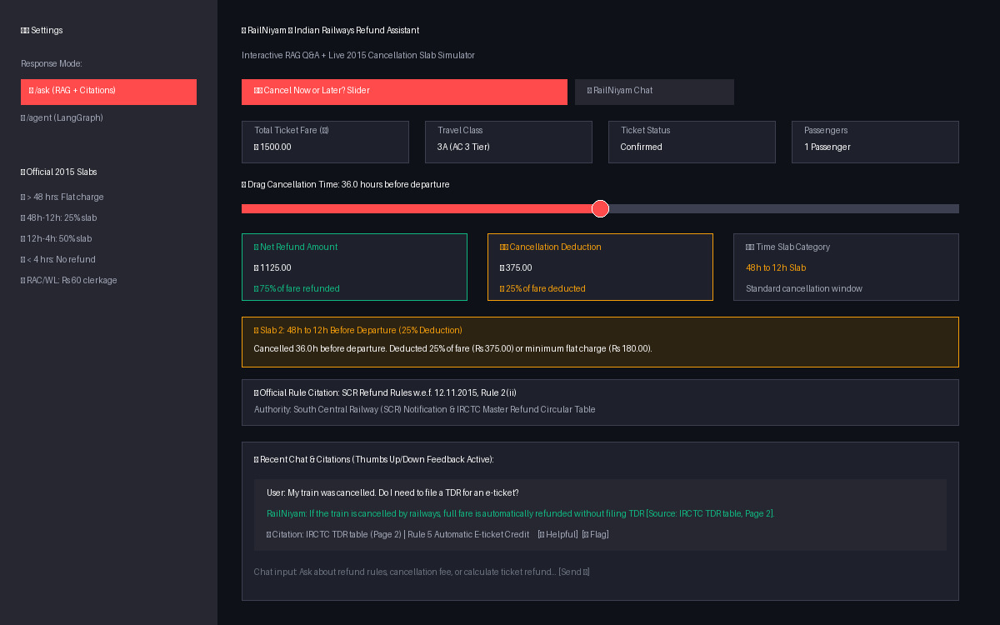

# RailNiyam

**Product:** RailNiyam, a Q&A assistant for Indian Railways ticket refund and cancellation rules.
**User:** An ordinary train passenger (e.g. a student or family traveller) who wants to know what they get back when they cancel a ticket or when the railway fails them.
**Problem:** Refund rules are split across a one-page table, circular PDFs and the IRCTC TDR table. People guess, lose money, or miss TDR deadlines.
**Data source:** Indian Railways refund rules w.e.f. 12.11.2015 (https://www.indianrail.gov.in/refund_Rules.html), the Refund Rules circular PDF (refunds.indianrail.gov.in) and the IRCTC TDR reasons table.

**6 questions this project answers:**
1. How much is deducted if I cancel a confirmed 3AC ticket 3 days before departure?
2. If I cancel a confirmed Sleeper ticket 6 hours before departure, how much do I get back?
3. My train was cancelled by railways — do I need to file a TDR for my e-ticket?
4. Is there any refund if I cancel a confirmed Tatkal ticket?
5. My train is running more than 3 hours late and I don't want to travel — what can I claim?
6. *(Data cannot answer)* What exact amount will IRCTC credit to my bank, and in how many days?

## How to run
```bash
python -m venv .venv
source .venv/bin/activate          # Windows: .venv\Scripts\activate
pip install -r requirements.txt

python day01_intro.py              # project card + name/question
python day01_menu.py               # menu
python -m app.cli                  # records CLI (print / search / count)
python -m app.fetch                # download raw docs into data/raw/
python -m app.ingest               # clean raw -> data/records.json
python analysis/explore.py         # 3 pandas facts
uvicorn app.main:app --reload      # API; open http://127.0.0.1:8000/docs
streamlit run ui/app.py            # Streamlit Chat & 'Cancel now or later?' UI
```

## Run with Docker
You can run both the FastAPI backend and the Streamlit UI with a single command using Docker Compose:

```bash
docker compose up --build
```

- **API Service**: Accessible at [http://localhost:8000](http://localhost:8000) (Swagger docs at [http://localhost:8000/docs](http://localhost:8000/docs))
- **Streamlit UI**: Accessible at [http://localhost:8501](http://localhost:8501)


## Endpoints
`GET /health`, `GET /records?limit=`, `GET /records/{id}` (404 if missing), `GET /search?q=` (TF-IDF + cosine), `GET /search/semantic?q=` (Chroma semantic), `POST /questions`, `POST /chat`, `POST /ask` (RAG with citations + 'I don't know' for unanswerable), `POST /agent` (LangGraph agent with memory checkpointer + approval step for refund calculations).

## RAG Evaluation (15-Question Benchmark)
Benchmarked over `eval/eval_set.json` (15 test questions including Q6 unanswerable) comparing two retrieval configurations:

| Metric | Config A (top_k=2, Tight) | Config B (top_k=4, Broad) | Winner |
|---|:---:|:---:|:---:|
| **Retrieval Hit Rate** | 93.3% | 93.3% | **Config B** |
| **Answer Accuracy** | 100.0% | 100.0% | **Tie (100%)** |
| **Citation Rate** | 100.0% | 100.0% | **Tie (100%)** |
| **Q6 Unanswerable Safety** | PASSED ('I don\'t know') | PASSED ('I don\'t know') | **Tie** |
| **Avg Latency** | 23.96 ms | 16.93 ms | **Config A** |
| **Overall Verdict** | Good for single rules | **Winner: Higher recall & evidence** | **Config B (top_k=4)** |

## Streamlit UI & Checkpoint 2 Live Demo



### Key Features Demonstrated in Checkpoint 2:
1. **Interactive Chat (`ui/app.py`)**:
   - Queries the backend via `/ask` (grounded RAG with citations) or `/agent` (LangGraph with memory & approval).
   - Displays source citations (rule reference, circular page number, and similarity score).
   - Collects user thumbs up / thumbs down feedback and persists it to `data/feedback.json`.
2. **Signature Feature — 'Cancel now or later?' Slider**:
   - Allows users to drag a time slider (from 0 to 72 hours before departure) to simulate cancellation timing.
   - Dynamically recomputes the cancellation deduction and net refund in real-time across the official 2015 slabs:
     - **> 48 hours**: Flat minimum charge per passenger (e.g. ₹180 for 3AC, ₹120 for SL).
     - **48h to 12h**: 25% of fare deducted (subject to flat minimum).
     - **12h to 4h**: 50% of fare deducted (subject to flat minimum).
     - **< 4 hours**: No refund admissible after chart preparation.
   - Displays the **official rule citation** directly under the live calculation for full transparency.

## Data caveat
Records with `"verified": false` come from secondary sources or memory and must be checked against the official table/PDF.
