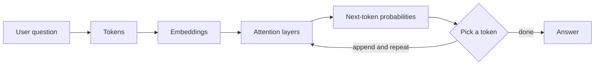

# How LLMs work (in my own words)

A large language model (LLM) is a program that has read a huge amount of text and learned
one skill: **given the words so far, guess the next word.** It does this one small piece
(a *token*) at a time, over and over, until the answer is finished.

1. **Tokenising.** My question is cut into tokens (word pieces) and each becomes a number.
2. **Embedding.** Each number is turned into a list of numbers (a vector) that captures its meaning.
3. **Attention.** The model compares every token with every other token to decide which
   ones matter. In "cancel my *Tatkal* ticket", *Tatkal* matters a lot for the refund.
4. **Prediction.** It scores every possible next token and picks one, then repeats.

## Why this matters for RailNiyam
An LLM only knows what it learned in training, which may be old or wrong. Refund rules
change (they changed on 12.11.2015) and the model can sound confident while being wrong
(a *hallucination*). So RailNiyam keeps the real rules in its own records, **searches**
them first (TF-IDF now, maybe embeddings later) and only lets a model explain what was
found. If the data has no answer, RailNiyam should say so instead of guessing.
